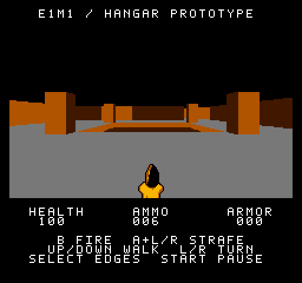
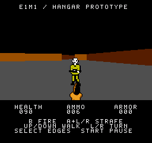

# Hangar — an NES FPS prototype

A playable 3D first-person shooter experiment for the **NTSC Nintendo
Entertainment System**, with angled walls, a recessed floor, moving enemies,
pickups and a complete route through a simplified adaptation of Doom's
E1M1 / Hangar.

The renderer constructs solid surfaces and their boundary tiles at runtime
on the NES CPU. This is a custom engine and a compact technical/gameplay
prototype, not a port of the Doom engine or the complete original level.

**[Play in browser](https://8bitpocket.app/?game=hangar)** ·
[Download the ROM](release/hangar-ntsc.nes) ·
[Build from source](#build-from-source) ·
[Technical notes](#how-it-renders) ·
[Provenance](docs/PROVENANCE.md)

<p align="center">
  
</p>
<p align="center">
  Actual ROM gameplay at normal NTSC timing in JSNES · <a href="docs/images/opening-gameplay.png">View the opening still</a> · <a href="docs/images/title.png">Title and controls screen</a>
</p>

## Play

Download `release/hangar-ntsc.nes` and open it in an NES emulator with MMC1
and CHR-RAM support. The development reference is
[Mesen](https://www.mesen.ca/), using **NTSC**, normal sprite limits and
**zero additional scanlines**. Those settings exercise the intended timing.
Optional emulator overclocking can make rendering faster, but it is not
required to finish the level.

Press Start on the title screen. The first room takes about 0.8 seconds to
prepare at normal NTSC speed; the level timer starts when that view appears.

For a browser trial, open [Play Hangar](https://8bitpocket.app/?game=hangar),
click **Play Hangar**, then press **Start** on the game title screen. Hangar is
also in the site’s hosted-game picker. A keyboard guide appears before Play;
use **Controls** to reopen it during gameplay. **Open ROM** still supports downloaded
files. Browser speed, palette and presentation may differ from Mesen. See
the [browser deployment notes](docs/DEPLOYMENT.md).

## Controls

| Input | Action |
| --- | --- |
| Up / Down | Walk forward / backward |
| Left / Right | Turn |
| Hold A + Left / Right | Strafe |
| B | Fire the pistol |
| A, while facing a nearby door or switch | Use when prompted; release and press again, without Left/Right |
| Start | Begin from the title; pause/resume during play; retry after death or completion |
| Select | Compare precise dynamic boundaries with coarse tile boundaries |

Pausing displays a message at the top and plays a short descending cue.
Resuming restores the level heading and plays an ascending cue. Gameplay and
the completion timer stop during pause. Hardware/emulator Reset returns to
the title; retries go directly back into the level.

With no ammunition, a fresh B press plays a brief, deep empty-gun buzz. Holding B
does not repeat the cue or count as a fired shot.

## The current level

Find the exit switch beyond the slime room and the openable door. The level
contains two soldier encounters, one medkit and one ammunition clip. You can
finish without killing every enemy or collecting every item; the completion
screen reports kills, items and elapsed time.

- Start with 100 health and **6 rounds**. Each soldier takes three hits.
- The gray clip supplies 10 rounds; it is on dry ground near the slime-room
  entrance. Missing shots makes it useful.
- The medkit restores up to 25 health and remains available at full health.
- Green slime costs 5 health after roughly one second, repeating while you
  remain on it. The gray zigzag walkway is safe.
- Soldiers pursue within authored encounter bounds, telegraph their shots,
  react to hits and leave a short-lived corpse.

The room layout retains the opening pillars and recess, connecting passages,
two encounter areas, zigzag slime room, pre-exit room and exit chamber. It
omits much of the original map's geometry, branches, lighting and decoration.

| Opening room | First encounter |
| --- | --- |
|  |  |

These are native 256 × 240 captures from the initial public build in Mesen at
normal NTSC timing, with the hardware sprite limit enabled. The current build
retains the same artwork and level geometry.

## Build from source

The repository is self-contained. Building requires **Python 3.11 or newer**
and the **ca65 assembler / ld65 linker** from
[cc65](https://github.com/cc65/cc65). GNU Make is optional. No WAD, commercial
ROM, emulator, npm package or Python package installation is needed to build.

### macOS

With Homebrew installed:

```sh
brew install python cc65
```

[Homebrew's cc65 package](https://formulae.brew.sh/formula/cc65) supplies both
`ca65` and `ld65`. Open a terminal in this repository and run:

```sh
python3 tools/build.py
```

### Debian / Ubuntu and Windows with WSL

```sh
sudo apt-get update
sudo apt-get install python3 cc65 make
python3 tools/build.py
```

On Windows, WSL with Ubuntu is the documented build route. A native Windows
Python/cc65 setup may also work, but it has not been verified for this package.

### Output and verification

The output is **`build/hangar-ntsc.nes`**. The build also produces assembler
listings, linker/debug files, generated assets and a manifest under `build/`.
Generated files are ignored by Git. Asset generation includes geometric
visibility calculations, so allow a minute or more on the first build.

To rebuild and compare against the included release:

```sh
python3 tools/build.py --verify
```

Or use the Make targets:

```sh
make
make verify
make clean
```

`make clean` removes generated build output, not the ROM in `release/`.
Normal builds permit intentional source edits; verification is expected to
fail if those edits change the ROM relative to the committed release.

The included release is 65,552 bytes (a 16-byte header plus 64 KiB PRG), with
SHA-256:

```text
08ba1092db774a1c543345274f0835c8ca2413a725484a870286a746fa9c2462
```

The checksum and cartridge metadata are also in [release/](release/).
[Verification notes](docs/VERIFICATION.md) distinguish isolated build checks,
emulator observations and hardware testing. The GitHub Actions workflow
rebuilds and compares the ROM on push or pull request; it does not deploy a
website or publish a release automatically.

### Troubleshooting

- **ca65/ld65 not found:** install cc65, then check `ca65 --version` and
  `ld65 --version` in the same terminal used to run the build.
- **Missing Python modules:** the normal build uses the standard library.
  Run the documented Python version; there is no requirements.txt to install.
- **ROM mismatch after editing:** use the normal build while developing.
  Update the checked-in ROM and release metadata together only after testing
  an intentional new release.
- **Slow or corrupted emulator display:** confirm NTSC, mapper support and
  the ROM checksum. Compare with Mesen before treating a browser-only issue
  as a game regression.

## Source layout

| Path | Purpose |
| --- | --- |
| `src/` | 6502 assembly, RAM definitions and the cartridge linker configuration |
| `tools/` | Python build driver, geometry/visibility generators and art generators |
| `assets/map.json` | Editable, simplified level geometry and gameplay placement data |
| `assets/pistol-sheet.png` | Editable two-frame pistol/hand source image |
| `assets/` | Other source data used by the generators, including the font |
| `release/` | Playable reference ROM, checksum and release metadata |
| `docs/` | Provenance, verification and proposed browser deployment |
| `build/` | Regenerated local output; excluded from Git |

Start with `src/walkable.s` for boot, controller polling, main/NMI coordination
and frame publication. `geometry.s` projects the scene; `raster.s` constructs
background patterns; `ntsc_upload.s` budgets PPU transfers. Movement,
encounters, shooting, pickups, doors, results, pause and the title screen have
their own modules.

Edit the map and generator inputs rather than generated `.inc` or `.bin`
files. The current map includes derived segments, visibility zones and floor
regions: editing it is a technical workflow, not yet a general map editor.
Changes to geometry can require corresponding visibility/collision changes.
The generators enforce capacity and geometric assumptions during a build.
In particular, the door, rectangular recess, two encounter slots and room
handoff bounds are scene-specific. Changes there can require edits to
`tools/door_reference.py`, `ai_reference.py` and `encounter_reference.py`.
Enemy and item pixels are authored in `tools/zombie_assets.py`,
`medkit_assets.py`, `ammo_assets.py` and `corpse_assets.py`; the font is in
`assets/font.json`.

## How it renders

The world is defined by finite wall segments and horizontal floor regions.
Fixed-point camera transforms and depth calculations produce visible vertical
spans. The renderer evaluates **128 horizontal samples**, duplicates each
across two screen pixels and retains full vertical resolution in a
**256 × 144** viewport.

Uniform tile interiors reuse a few solid patterns. At edges and intersections,
the CPU constructs the required pixel patterns in RAM, reuses matching cached
patterns and uploads them to CHR-RAM. This is why angled walls can rotate
smoothly even though the NES background is tile-based. Select makes the
difference visible by switching to the coarse boundary comparison.

The main thread builds an immutable world view while NMI handles bounded PPU
uploads, controls, gameplay ticks and audio. Publication switches to a completed
view rather than exposing a partly uploaded picture. Visibility tables reduce
work for hidden rooms. Enemies and pickups use distance-sized hardware sprites
with foreground masks derived from the world geometry.

The cartridge uses **MMC1 banking, 64 KiB PRG, 8 KiB CHR-RAM and 8 KiB work
RAM**. Rendering is performed by the NES CPU; the mapper provides banking,
not a 3D processor. This is a cartridge configuration target, not a claim that
this release has already been tested on a physical console.

## Current limitations

- Rendering is scene-dependent and substantially slower than the display's
  refresh rate. The opening recess/pillars and views across the slime room
  are demanding; control-to-picture latency remains noticeable.
- Two encounters persist in the level, but only one enemy encounter is active
  at a time. Crossing a handoff can hide the outgoing soldier or corpse.
- Sprite size steps, very close actors and sprite-per-scanline pressure remain
  visible limitations. This is not an engine for crowds of enemies.
- The green slime palette shares a limited set of background colors; visible
  slime replaces one alternate wall shade.
- Armor is a HUD placeholder. There are no armor pickups, extra weapons,
  additional levels, saves or general-purpose WAD loader.
- PAL is not the target for this packaged release. Physical-console and
  flash-cartridge testing remain separate from emulator verification.

When reporting a problem, include the ROM checksum, emulator/version, region,
overclock settings and a reproducible route or short recording.

## Sharing and browser deployment

The suggested repository name is **`nes-hangar`**; the display title is
**Hangar — an NES FPS prototype**. This directory is the repository root, so
only this folder needs to be published, not the surrounding research workspace.
See [publishing instructions](docs/PUBLISHING.md).

The maintained 8-Bit Pocket emulator now hosts the exact release ROM and
supports the [direct Play Hangar link](https://8bitpocket.app/?game=hangar).
A dedicated landing page with download and play buttons can follow. The
[deployment notes](docs/DEPLOYMENT.md) describe the current integration,
remaining display work and options for a later custom domain.

## Credits and licensing

The project was developed through iterative implementation, emulator testing
and player feedback, with AI-assisted coding and analysis. Its dynamic tile
approach was inspired in part by studying NES Elite's graphics technique;
this package uses a newly written renderer, not that game's engine code.

The included map is a simplified adaptation of Doom's E1M1 by id Software.
The source and visual-reference history are recorded in
[PROVENANCE.md](docs/PROVENANCE.md). Code licensing and content provenance are
separate; no blanket license over the original game's level design or reference
artwork is implied.

Original engine code and build tools are licensed under [MIT](LICENSE).
See [LICENSE-SCOPE.md](LICENSE-SCOPE.md) for the distinction between that code
grant and the bundled level/visual content, which has no separate content
license assigned here.
