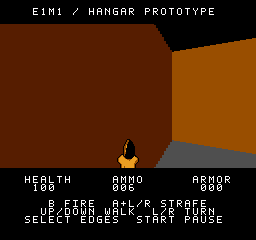
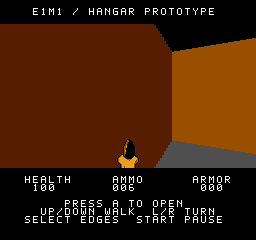

# Close-angle door interaction

This page records the earlier facing-angle fix. The current build also
extends the door use distance to twelve units; see [DOOR-REACH.md](DOOR-REACH.md).

`prototype-2026-10-22-door-angle` makes the door prompt easier to find when
standing close to either side of the doorway. It retains the latency
improvements and optional music from the previous build.

## Reproduction

The previous interaction and latency builds both reject several legal
positions where the player is looking directly into the closed door panel.
The cause is the facing test: it allows only 45 degrees to either side of
the panel normal. Near a jamb, aiming toward the middle of the door can
require a much larger angle, even though the player is well within reach.

For example, at X300, Z122.25, angle171 (about 60 degrees from the normal),
the forward sightline meets the door almost exactly at its center. Collision
permits this position, but the previous facing test hides the prompt and
rejects a fresh A press. Equivalent cases occur on both sides of the door.
Matched emulator runs reproduce this in both previous builds, so the tested
failure predates the latency optimization.

The same settled view in stock-NTSC Mesen, music ON:

| Previous build | Updated door prompt |
| --- | --- |
|  |  |

## Change

The facing allowance is now 53 angle units, about 74.5 degrees, to either
side of the panel normal. This covers center-directed approaches at the
closest legal positions beside both jambs. It deliberately gives nearby
use a little angular tolerance rather than requiring exact crosshair aim.

- North-side allowed angles: 75 through 181, inclusive.
- South-side allowed angles: 203 through 255 and 0 through 53, inclusive.
- Reach remains X[288,304), with north Z(122,128] and south Z[112,118).
- A fresh A press activates the door. A+Left/Right still strafes; holding A
  before entering range still requires releasing and pressing it again.
- The door remains solid until the matching open picture becomes visible.

Only four immediate values change in the binary. Code size, RAM, linked
addresses, rendering, uploads, music, ammo collection and exit-switch rules
are unchanged. This addresses prompt eligibility, not the remaining delay
between requesting an opening and displaying it.

## Verification

The portable linked-CPU test checks all 256 facings across fractional range
boundaries, plus input guards, collision and request/publication behavior.
Eight collision-legal close-contact poses are tested with music ON and OFF.
All sixteen cases reject prompt/use in the previous ROM and accept it in the
candidate. The complete run passes 51,838 routine calls.

```sh
node tests/door-exit-interactions.mjs --build build --core /path/to/jsnes/src/index.js --output build/door-exit-interactions.json
```

Optionally pass `--baseline-build /path/to/previous-build` to reproduce the
old rejection. That baseline must use the previous 45-degree door cone.
The linked test injects poses; emulator rendering and controller tests are
recorded separately in [verification](VERIFICATION.md).

The previous accepted ROM is preserved as
`hangar-latency-ntsc.nes` (local research archive; not bundled).
This report describes the earlier local candidate, not a physical-console
test. Its facing-angle change remains in the current published release;
see [deployment](DEPLOYMENT.md) for the separate publication checks.
