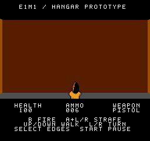
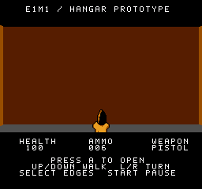

# Door reach and the centered approach

The door now offers **PRESS A TO OPEN** from twelve world units away, up from eight. The facing check, panel width, collision and use-button behavior are unchanged. This changes two distance constants and adds no rendering work or new per-frame routine.

## What was reproduced

A centered, perpendicular view at `(296,128.25)`, facing angle 128, places the camera 8.25 units from the panel. The door nearly fills the viewport, making it look close enough to use. The previous eight-unit reach still rejected that position: there was no prompt and a fresh A press did nothing. The new reach accepts it.

| Previous eight-unit reach | New twelve-unit reach |
| --- | --- |
|  |  |

The world and pistol pixels in these screenshots are identical. Only the status message differs.

We did **not** reproduce an intermittent rejection at the actual physical collision limit. All tested legal contact positions worked in the previous build as well as the new build. This change addresses a demonstrated mismatch between apparent proximity and interaction reach; a report that persists at actual contact still warrants investigation.

## Preserved behavior

- A fresh A press opens the door. Holding A while walking into range displays the prompt, but requires releasing and pressing A again.
- A+Left/Right continues to strafe without opening the door.
- The player must remain on a legal side of the panel and within its lateral width. The existing facing cone is unchanged.
- Collision remains in place until the matching open-door picture has been published. This update does not change rendering latency.
- Dead players, completed levels, facing-away poses and positions beyond the new range cannot activate the door.

The exact eligible bands are `X[288,304), Z(122,132]` on the north side and `X[288,304), Z[108,118)` on the south side. Those coordinates describe interaction only; they do not enlarge the player's collision footprint or allow movement through walls.

## Verification

[The portable verification report](../verification/door-center.json) records the ROM hashes, measurements and limitations.

- Stock-NTSC Mesen, no extra scanlines, both music options selected through the controls guide: 16,636 measured refreshes across matched previous/current runs. Eight visually close poses per music mode now work; poses immediately beyond twelve units still reject use. Forty matched world-image fixtures remain pixel-identical.
- Real JSNES controller movement from legal fixtures: 120 before/after cases covering both sides, both music options, three near-perpendicular facings per side and five fractional starting positions. Every actual-contact prompt and fresh-A activation passes.
- Linked 6502 checks cover 42,240 door-boundary poses, 20,480 exit poses, input guards, collision and publication sequencing. The new regression also compares 24 extended-reach cases to the previous build and retains 16 true-contact controls. The earlier close-angle correction remains covered separately.

The focused emulator tests inject legal initial positions and clear enemies to isolate the door. They are not a substitute for a full playthrough or testing on a physical console. Each Mesen run uses its own temporary settings directory and verifies that personal settings remain unchanged.

Run the linked checks against a local JSNES installation:

```sh
node tests/door-center-interactions.mjs \
  --build build \
  --core /path/to/jsnes/src/index.js \
  --output build/door-center-interactions.json
```

Use optional `--baseline-build /path/to/previous-build` to compare against the preceding eight-unit-reach build. Both build directories need their matching ROM and `hangar.lbl`. The older angular regression remains in `tests/door-exit-interactions.mjs`; its optional baseline expects the historical 45-degree cone, not the preceding release.
