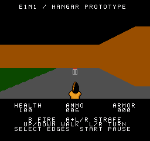
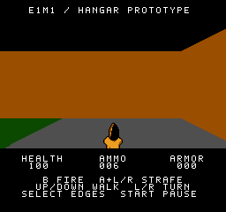
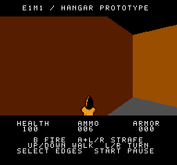
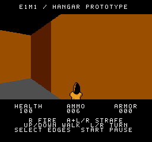

# Ammo, door and exit interaction repros

These observations use the integrated optional-music ROM,
`c2a913ddd057235e11936e4c212eb0d3a93e1c6f422315d03bd05baaea80ab1b`.
This historical pass reproduces usability problems; it does not change
interaction rules. The later [interaction fixes](INTERACTION-FIX.md) adjust
the thresholds and document which presentation limitations remain.

## Ammo disappears before it can be collected

A direct approach from `(290,252)` toward the clip at `(274,252)` starts with
the clip visible. Stopping at `(277.5,252)`, 3.5 world units away, leaves the
ammo count at 6. Even after the world view catches up, the clip is completely
below the viewport. Continuing closer collects it at 2.75 units and raises
the count to 16.

| Visible on approach | Settled at 3.5 units; still uncollected |
| --- | --- |
|  |  |

The pickup test also rounds each absolute distance upward to the next eighth
of a world unit before applying a strict radius of 3. A lateral pass at
2.875 units collects; a pass at 2.8984375 units does not. This follows the
deliberately conservative implementation, but creates a narrow inward bias.

Centerline forward, backward, strafe and diagonal passes collect reliably.
The active encounter stays correct. Full-ammo refusal cannot explain ordinary
play: the level supplies at most 16 rounds, below the 99-round cap.

A narrow follow-up would compare a strict 3.5-unit radius against the current
radius, preserving the previous wall-side bypass tests. That would improve
near-edge contact, but would not fully solve the below-viewport presentation:
an equal-distance frontal and lateral approach cannot be distinguished by a
circle alone. Close-range presentation or a small placement adjustment should
be evaluated separately if needed. Restoring the medkit's much larger radius
would reintroduce the earlier sideways pickup complaint.

## Door and switch reject some correctly aimed approaches

Both checks compare player facing with the wall's normal direction, rather
than the direction from the player to the target. These legal, fully settled
poses put the target's center directly ahead but still reject interaction:

| Target | Player X,Z | Angle (0–255) | Current outcome |
| --- | --- | --- | --- |
| Door center `(296,120)` | `(300,124)` | 160 | No prompt |
| Switch center `(284,28)` | `(288,32)` | 160 | No prompt |

The door allows only ±22.5° from its normal, and the exit ±28.125°. Both
examples approach at 45°. The door also excludes `(302.5,116)`, angle 0,
although this is a legal position within the panel's horizontal span. Its
interaction rectangle is narrower than the door itself.

| Diagonal door approach | Diagonal exit-switch approach |
| --- | --- |
|  |  |

The next bounded experiment should allow a ±45° facing range and the door's
full lateral span, retaining distance, wall-side, physical-collision and input
guards. A fresh A press is intentionally required; holding A while approaching
or using A+Left/Right to strafe does not activate either target.

## Prompt updates and delayed world views are separate

On ordinary approaches and while firing, an eligible interaction appears in
both HUD nametables one NTSC refresh later, with music either ON or OFF.
These tests found no reason to change the HUD upload schedule.

Turning does expose a live-state/display mismatch. The prompt follows the
current facing, while the world still shows an older camera angle. In the
specific close door/exit fixtures, the displayed angle took 20/45 refreshes
to leave the eligibility cone with music ON, and 19/44 with music OFF. These
are scene-specific observations, not general performance averages. They
provide useful fixtures for the later input-to-picture latency investigation.

Ammo checks likewise use the live position. During one moving collection,
the displayed camera was 15 world units behind the live position. The settled
invisible-ammo example above persists after that delay ends, so latency does
not account for all of the pickup confusion.

## Method and evidence

- Ammo: 17 cases over 2,838 stock-NTSC Mesen refreshes, including legal movement
  from several directions, fractional boundaries, full-ammo control and OFF
  duplicates. No observer errors or nested NMI.
- Door/exit: 36,880 linked boundary/input checks, plus 1,752 Mesen refreshes
  per music mode. No coordinate arithmetic defect was found.
- Diagnostic legal starting poses are injected while idle; enemies are
  disabled to isolate interactions. Subsequent motion uses controller input.
  These are not controller-only whole-level runs or physical-console tests.
- ROM bytes and personal Mesen settings remain unchanged. Screenshots above
  are unmodified emulator captures.

The compact results and source-report hashes are in
[interaction-repro.json](../verification/interaction-repro.json). Detailed
local traces, drivers and screenshot galleries remain under the ignored
`analysis/interaction-repro/` directory.
