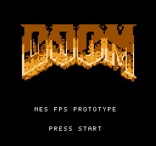

# DOOM-logo title

The selected title is now part of `prototype-2026-10-21-bronze-title`.
Cold start displays a black full-screen title with a 192×94 **bronze DOOM
logo**, followed by the existing controls guide. Each screen requires its
own fresh Start press; holding Start cannot skip either page. Internal level
retries and completion restarts still skip the startup screens.



The default build and `release/hangar-ntsc.nes` use bronze. Rebuild and verify
that release with:

```sh
python3 tools/build.py --verify
```

Grayscale, blue/gold and steel remain optional build-time comparisons, described
in [the palette notes](TITLE-PALETTE-COMPARISON.md). Their ROMs intentionally
differ from the accepted release. The hosted browser game has not been changed
by this integration; it still uses the earlier third-encounter release.

This document retains the original isolated experiment's design and validation
history. The historical grayscale build and the preceding sprite-stability
release are identified below; they are not the current default.

## Artwork provenance

`assets/newlogo-doom.json` is a derived indexed version of the **M_DOOM** menu
logo from the user-supplied Doom shareware WAD. The logo is id Software's
artwork, not original project artwork and not covered by the MIT grant for
original engine code. The source WAD is not included or required by normal
builds; its derived indexed logo source is included and documented separately
from the original-code license.

The indexed source records the input WAD and lump SHA-256 values. It was
imported with:

```sh
python3 tools/newtitle_logo.py --import-wad /path/to/Doom1.WAD
```

The importer decodes the original patch posts and palette, retains dark blue
letter faces as gray, and converts the bronze portions to three grayscale
levels plus black. Plain opacity loses the letter gaps; ordinary luminance
alone makes the dark blue upper faces disappear. The explicit palette-aware
conversion preserves both without extracting any gameplay art or code.

The 123×60 source is resampled at pixel centers to 96×47, then expanded exactly
2× to 192×94. The accepted bronze output uses NES colours `$0F`, `$17`, `$27`,
and `$37` (black, brown, amber and cream). The earlier grayscale reference used
`$0F`, `$00`, `$10`, and `$30`; its pixel indices and generated patterns are
identical. The fixed-font subtitle and prompt remain white in every palette.

## ROM and startup behavior

The generator deduplicates 186 logo patterns at tile indices 64–249. Existing
font patterns 0–63 remain byte-identical. The 2× expansion duplicates adjacent
pixel rows; the source stores each row pair once and the boot-only uploader
writes each stored byte twice. This is lossless for the generated NES tiles.

The logo adds 1,488 stored pattern bytes, a 1,024-byte nametable and a 32-byte
palette: 2,544 asset bytes before its small loader. All additional code and
assets live in `BOOTDATA`, which uses 7,376 of 8,192 bytes in this build
(816 bytes remain). All other segment sizes match the preceding sprite-stability
build. The mapper, 64 KiB PRG size, 8 KiB CHR RAM, 8 KiB work RAM, world
renderer, NMI schedule, combat data and gameplay budgets are unchanged.

Both page uploads occur with rendering and NMI disabled. The guide uses the
retained fixed font; after the guide, the existing `boot_scene_init` clears
and reloads both CHR tables, CPU/PPU nametables, palette and gameplay state.
The ordinary initial-picture gate still freezes the level timer and gameplay
until a completed world view is visible.

Generated byte-decoded previews and packing assertions are under `build/`.
The logo generator independently decodes its nametable/palette/tile output,
checks every logo pixel, verifies row-pair packing, and asserts the complete
fixed font remains intact. The compact runtime report is
`verification/title-screen-experiment.json`; the research harness and raw
captures remain local under `analysis/`. That harness depends on the larger
research workspace and is not needed to build the standalone release.

The original grayscale experiment's controller-only Mesen testing used stock
NTSC timing, normal sprite limits, and no extra scanlines or RAM injection. Across 14,780 refreshes and 136 test
phases, the logo and guide required separate fresh Start presses, both pages
froze gameplay, and the first game view restored the preceding sprite-stability
release's complete PPU memory and screen pixels exactly. The route defeated all three
soldiers, collected both items, completed the level, and restarted directly
into gameplay. The render limits were preserved and the observer reported no
runtime errors. This verifies emulator behavior, not physical-console timing.

The grayscale test ROM SHA-256 is
`8b24fd1875e01e51ea7dacbb68bc6b7ac905fca1c791fd1804d20c9638f1a0ee`.
The preceding sprite-stability release, retained at Git commit `d2f2bbd`, is
`f342c5b83f75be92fdf476fab0b2c802afe06438e41e5b571d98b501c05de28e`.

The current bronze release is
`c715b34bd688927579d20d6c593dbddb8436ca4a38dab4b78f553a5d04afe251`.
It differs from the grayscale title only in three palette bytes. Its separate
startup and PPU-restoration comparisons are documented in the
[palette notes](TITLE-PALETTE-COMPARISON.md); current release verification is
summarized in [VERIFICATION.md](VERIFICATION.md).
